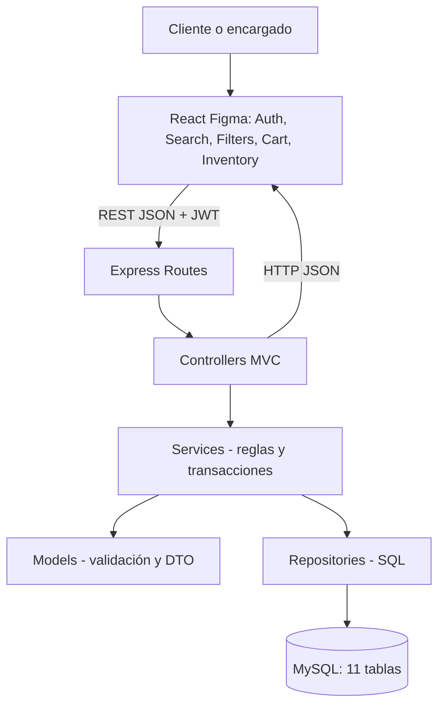

# Arquitectura del sistema: Frontend Figma + N capas MVC backend

**Frontend no es la capa del servidor MVC.** El patrón MVC más arquitectura en N capas se aplica al backend. React corresponde a la capa de presentación; no debe consultar MySQL directamente.

- `AuthModal` → `lib/api` → `auth.routes` → `AuthController` → `AuthService` → `UsuarioRepository` → `usuarios`.
- `Products` búsqueda → `productos.routes` → `ProductosController.search` → `ProductosService.search` → `ProductoRepository.list` → vista `vw_catalogo`.
- `Products` filtros → `ProductosService.list` → `parseFilters` → `ProductoRepository.list`.
- `CartSidebar` → `PedidosController.create` → `PedidosService.create` → `ProductoRepository.lockIds` y `PedidoRepository.*` (transacción).
- `InventoryPanel` → `ComprasController.create/receive` → `ComprasService.create/receive` → `CompraRepository` y `ProductoRepository` (transacción).
- `OrdersPanel` → `PedidosController.close` → `PedidosService.close` → `PedidoRepository` → tablas `pedidos`, `pagos`.
